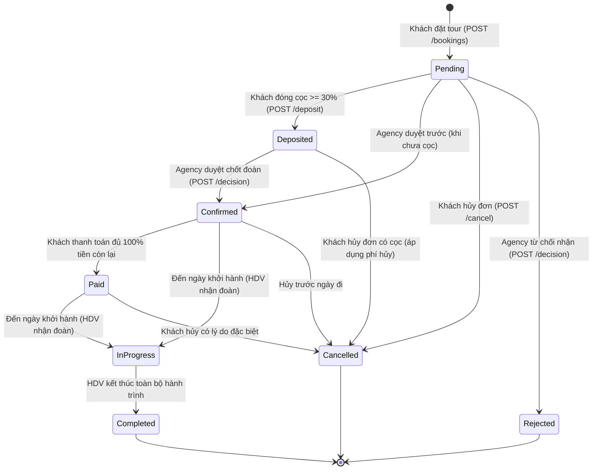

# Ma trận 8 Trạng thái Đặt tour & Vận hành (Booking Status Matrix)
**Hệ thống TripOps - Workflow 05 & Workflow 06**

---

## 1. Bảng Ma trận 8 Trạng thái Đơn đặt tour (`Booking.Status`)

Để khắc phục hiện tượng *"Đã đặt cọc nhưng trạng thái đơn vẫn hiển thị là Chờ xác nhận & chốt giá"*, hệ thống chuẩn hóa chu trình đơn hàng thành **8 trạng thái** rõ ràng:

| STT | Trạng thái | Mã Enum | Ý nghĩa nghiệp vụ | Điều kiện chuyển dịch | Người thực hiện / Sự kiện |
| :---: | :--- | :--- | :--- | :--- | :--- |
| **1** | **Chờ xử lý / Chờ cọc** | `Pending` | Đơn mới tạo thành công, đang chờ khách thanh toán tiền cọc hoặc chờ thỏa thuận giá. | Khách hàng hoàn tất gửi form đặt tour qua `POST /api/v1/bookings`. | Khách hàng |
| **2** | **Đã đặt cọc** | `Deposited` | Khách đã thanh toán cọc thành công ($\ge 30\%$). Đơn đã được đảm bảo giữ chỗ chắc chắn. | Khách thanh toán cọc thành công qua `POST /api/v1/bookings/{id}/deposit`. | Khách hàng / Cổng thanh toán |
| **3** | **Đã xác nhận** | `Confirmed` | Công ty lữ hành (Agency) đã duyệt đơn, xác nhận chỗ và tiến hành ghép đoàn, chuẩn bị khởi hành. | Agency duyệt đơn qua `POST /api/v1/agency/bookings/{id}/decision` (`decision = "approve"`). | Công ty lữ hành (Agency) |
| **4** | **Đã thanh toán đủ** | `Paid` | Khách hàng đã hoàn tất thanh toán 100% tiền tour qua ký quỹ trước ngày khởi hành. | Khách thanh toán số tiền còn lại qua `POST /api/v1/bookings/{id}/deposit` đạt 100% tổng tiền. | Khách hàng / Cổng thanh toán |
| **5** | **Đang diễn ra** | `InProgress` | Đoàn khách đã khởi hành, Hướng dẫn viên đang dẫn đoàn và thực hiện check-in các điểm tham quan. | Đến ngày khởi hành và HDV phụ trách bắt đầu tiến hành chuyến đi. | Hướng dẫn viên (Guide) |
| **6** | **Hoàn thành** | `Completed` | Chuyến đi đã kết thúc thành công toàn bộ lộ trình theo kế hoạch. | HDV hoàn thành điểm danh chặng cuối và hoàn tất chuyến đi. | Hướng dẫn viên (Guide) |
| **7** | **Đã hủy** | `Cancelled` | Đơn bị hủy theo yêu cầu của khách hàng hoặc do quá hạn thanh toán. | Khách hàng gửi yêu cầu hủy đơn qua `POST /api/v1/bookings/{id}/cancel`. | Khách hàng / Hệ thống |
| **8** | **Bị từ chối** | `Rejected` | Đơn bị Công ty lữ hành từ chối tiếp nhận (do hết chỗ, trùng lịch hoặc lý do bất khả kháng). | Agency từ chối đơn kèm lý do qua `POST /api/v1/agency/bookings/{id}/decision` (`decision = "reject"`). | Công ty lữ hành (Agency) |

---

## 2. Bảng Ma trận Trạng thái Thanh toán đi kèm (`Booking.PaymentStatus`)

| Trạng thái Thanh toán | Mã Enum | Điều kiện số tiền thực trả (`paidAmount`) | Tương quan với Trạng thái Đơn (`Booking.Status`) |
| :--- | :--- | :--- | :--- |
| **Chưa thanh toán** | `Unpaid` | `paidAmount == 0` | Đơn thường ở trạng thái `Pending`. |
| **Đã đặt cọc** | `PartiallyPaid` | `0 < paidAmount < totalAmount` (thường là 30% - 50%) | Đơn chuyển sang `Deposited` (hoặc `Confirmed` nếu Agency đã duyệt). |
| **Đã thanh toán đủ** | `Paid` | `paidAmount >= totalAmount` (đạt 100%) | Đơn chuyển sang `Paid` hoặc sẵn sàng `InProgress`. |
| **Đã hoàn tiền** | `Refunded` | Xử lý hoàn tiền cho khách theo chính sách hoàn hủy | Áp dụng khi đơn chuyển sang `Cancelled`. |

---

## 3. Bảng ánh xạ đối chiếu màn hình danh sách (Giải quyết lỗi hiển thị thực tế)

| Mã đơn hiển thị | Trạng thái Đơn mới (`Status`) | Trạng thái Thanh toán (`PaymentStatus`) | Đánh giá hiển thị |
| :--- | :--- | :--- | :--- |
| `#pending-unpaid` | `Pending` (Chờ xử lý & cọc) | `Unpaid` (Chưa thanh toán) | Rất hợp lý (chưa đóng tiền, chờ cọc) |
| `#pending-deposit` | **`Deposited` (Đã đặt cọc)** | **`PartiallyPaid` (Đã đặt cọc)** | **Đồng bộ chuẩn 100%, không bị lệch pha** |
| `#confirmed-deposit` | `Confirmed` (Đã xác nhận đoàn) | `PartiallyPaid` (Đã đặt cọc) | Đã cọc và được Agency duyệt chính thức |
| `#confirmed-paid-100` | **`Paid` (Đã thanh toán đủ)** | **`Paid` (Đã thanh toán)** | **Đồng bộ chuẩn 100%, ghi nhận hoàn tất tiền** |

---

## 4. Sơ đồ Chuyển dịch Trạng thái Vòng đời (State Transition Diagram)

---

## 5. Ma trận các trạng thái vận hành vệ tinh (WF06 - Tour Operations)

### 5.1. Điểm danh hành khách (`Participant.AttendanceStatus`)
- **`Pending`**: Chờ điểm danh trước giờ xuất phát.
- **`CheckedIn`**: Hành khách đã có mặt tại điểm đón / lên xe.
- **`Absent`**: Hành khách vắng mặt khi xe khởi hành.

### 5.2. Phân công Hướng dẫn viên (`AssignedGuide.Status`)
- **`ASSIGNED`**: Agency vừa phân công HDV vào đơn tour qua `POST /api/v1/agency/bookings/{id}/guide-assignments`.
- **`CONFIRMED`**: Hướng dẫn viên đã xác nhận tiếp nhận lịch phân công.
- **`REJECTED`**: Hướng dẫn viên báo bận lịch không thể nhận đoàn.

### 5.3. Báo cáo sự cố tour (`Incident.Status`)
- **`REPORTED`**: HDV vừa tạo báo cáo sự cố qua `POST /api/v1/guide/bookings/{id}/incidents`.
- **`INVESTIGATING`**: Bộ phận điều hành của Agency đang xử lý và hỗ trợ đoàn khách.
- **`RESOLVED`**: Sự cố đã được xử lý xong và ghi nhận biên bản giải quyết.
